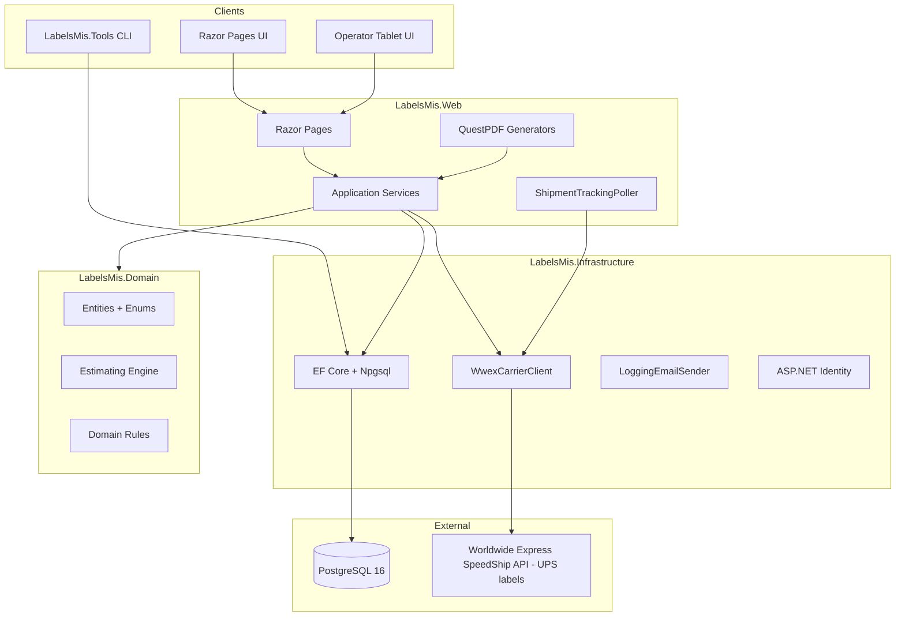

# Labels MIS — System Architecture

Tier 1 stack for a narrow-web label shop MIS (6 users, HP Indigo 6800).

## Layer rules

- **Domain** — business entities, estimating engine, carrier/Email interfaces. No EF, no HTTP.
- **Infrastructure** — EF DbContext, migrations, external clients.
- **Web** — Razor Pages, services, PDF, background workers.
- **Tools** — CSV importers for cutover (no UI).

## Document numbering

`PREFIX-YEAR-NUMBER` via the `DocumentSequence` table (one row per type and year): EST, SO, JOB, PO, SHP, INV, ROLL
barcodes. The year is the year the document was made. The number does **not** start again each year: a new year's row
begins at the highest number the type has reached (`DocumentNumberService`), so `INV-2026-00549` is followed by
`INV-2027-00550` and the number alone identifies the document.

## Equipment polymorphism (JobOperation)

`JobOperation.EquipmentType` + `EquipmentId` discriminates Press vs FinishingOperation. Pack/Ship/Inspection use `EquipmentType.None`.
